# 商品見積業務（Before）業務フロー・業務定義書

## 1. 想定ケース

### 1.1 対象企業
多品種の商品を扱う中堅の専門商社を想定する。  
顧客からメール・PDFで見積依頼を受け、営業担当者が商品検索、商品仕様確認、代替品探索、在庫・納期・価格確認、見積作成までを行う。

### 1.2 主な登場人物
- **顧客企業の購買担当者**：必要な商品・部品について見積を依頼する。
- **弊社営業担当者**：見積依頼を受領し、商品検索、仕様確認、在庫・納期・価格確認、見積作成、顧客回答を行う。
- **弊社商品担当者／ベテラン営業**：営業担当者だけでは商品の適合可否を判断できない場合に支援する。
- **弊社購買担当者**：必要に応じて仕入先の在庫・納期確認を行う。
- **弊社上長／承認者**：作成された見積内容を確認し、承認または差戻しを行う。
- **仕入先担当者**：仕入先システムで確認できない在庫・納期について個別に回答する。

### 1.3 使用システム・情報の所在
| 情報・業務 | 主な確認先／使用システム |
|---|---|
| 顧客からの見積依頼 | Outlook、PDF |
| 顧客情報・取引条件 | ERP |
| 商品マスタ | ERP |
| 商品仕様 | ERP、必要に応じてメーカーWeb・製品カタログ |
| 代替品探索 | ERP商品マスタ、メーカー資料、社内有識者 |
| 自社在庫 | ERP |
| 引当済在庫 | ERP |
| 入荷予定 | ERP |
| 自社からの提供可能日 | ERP上の在庫・引当・入荷予定をもとに確認 |
| 顧客別販売価格 | ERP |
| 仕入先情報 | ERP |
| 仕入先在庫 | 仕入先ポータル／仕入先システム |
| 仕入先からの取り寄せ納期 | 仕入先ポータル／仕入先システム |
| 仕入先システムで確認できない在庫・納期 | Outlookまたは電話で仕入先へ個別照会 |
| 見積書作成 | ERPのQuotation機能 |
| 顧客への見積回答 | ERP、Outlook |

### 1.4 Before業務の概要
顧客からPDF／メールで問い合わせ  
→ 仕様確認  
→ 商品マスタ検索  
→ 商品仕様確認  
→ 必要に応じて社内有識者へ確認  
→ 代替品探索  
→ 自社在庫・入荷予定・納期確認  
→ 必要に応じて仕入先在庫・取り寄せ納期確認  
→ 顧客別販売価格確認  
→ 見積条件整理  
→ 見積作成  
→ 上長承認  
→ 顧客回答

---

## 2. 業務フロー

```mermaid
flowchart TB

    START([開始<br/>顧客に製品調達・見積ニーズが発生])

    START --> WF01["WF-01｜見積依頼の作成<br/>顧客が要求仕様・数量・希望納期等を整理し、<br/>必要に応じて仕様書PDFを作成してメール送信"]

    WF01 --> WF02["WF-02｜見積依頼の受領<br/>営業担当者がOutlookでメール・添付PDFを確認"]

    WF02 --> WF03["WF-03｜顧客・取引条件の確認<br/>ERPで顧客情報・価格表・取引条件を確認"]

    WF03 --> WF04["WF-04｜要求仕様の整理<br/>メール・PDFから型番・材質・寸法・性能・規格・<br/>数量・希望納期等を整理"]

    WF04 --> D01{"商品仕様を<br/>一意に絞れるか？"}

    D01 -- "はい" --> WF06["WF-06｜商品マスタ検索<br/>ERPの商品マスタを型番・カテゴリ・属性等で検索"]

    D01 -- "いいえ" --> WF05["WF-05｜不足仕様の確認<br/>不足項目を整理し、顧客へメール・電話で追加確認"]

    WF05 --> R01(["WF-04 要求仕様の整理へ戻る"])

    WF06 --> WF07["WF-07｜商品仕様の詳細確認<br/>ERPの商品詳細および必要に応じて<br/>メーカーWeb・製品カタログを確認"]

    WF07 --> D02{"営業担当者だけで<br/>適合可否を判断できるか？"}

    D02 -- "いいえ" --> WF08["WF-08｜社内有識者への確認<br/>商品担当者・ベテラン営業へ仕様・候補商品を提示し確認"]

    D02 -- "はい" --> D03{"候補商品が<br/>顧客要求を満たすか？"}

    WF08 --> D03

    D03 -- "はい" --> D05{"見積対象商品が<br/>確定したか？"}

    D03 -- "いいえ" --> WF09["WF-09｜代替品探索<br/>ERP商品マスタ・メーカー資料・有識者情報から<br/>代替商品を探索・比較"]

    WF09 --> D04{"要求条件を満たす<br/>代替商品が見つかったか？"}

    D04 -- "はい" --> D05

    D04 -- "いいえ" --> R02(["WF-05 不足仕様の確認へ戻る"])

    D05 -- "はい" --> WF10["WF-10｜自社在庫確認<br/>ERPで倉庫別の現在庫・引当済在庫・<br/>利用可能在庫を確認"]

    WF10 --> WF11["WF-11｜入荷予定・自社納期確認<br/>ERPで発注残・入荷予定・引当状況を確認し、<br/>自社からの提供可能日を判断"]

    WF11 --> D06{"自社在庫・入荷予定で<br/>必要数量を希望納期までに<br/>確保できるか？"}

    D06 -- "はい" --> WF14["WF-14｜顧客別販売価格確認<br/>ERPで顧客ID・商品ID・数量を指定し、<br/>標準価格・契約価格・数量割引等を確認"]

    D06 -- "いいえ" --> WF12["WF-12｜仕入先在庫確認<br/>ERPで仕入先を特定し、仕入先システムで<br/>商品・在庫数量を確認"]

    WF12 --> WF13["WF-13｜仕入先納期確認<br/>仕入先システムで出荷可能日・<br/>取り寄せ納期を確認"]

    WF13 --> D07{"仕入先システムで<br/>在庫・取り寄せ納期が<br/>確認できるか？"}

    D07 -- "はい" --> WF14

    D07 -- "いいえ" --> WF13A["WF-13A｜仕入先への個別照会<br/>仕入先担当者へメールまたは電話で<br/>在庫・納期を問い合わせ、回答を受領"]

    WF13A --> WF14

    WF14 --> WF15["WF-15｜見積条件の取りまとめ<br/>商品・数量・単価・納期・取引条件・<br/>代替品差分等を整理"]

    WF15 --> WF16["WF-16｜見積書作成<br/>ERPのQuotation機能へ顧客・商品・数量・<br/>単価・納期等を登録しDraftを作成"]

    WF16 --> WF17["WF-17｜見積内容確認・承認<br/>上長が商品・数量・価格・粗利・納期・<br/>代替品条件等を確認"]

    WF17 --> D08{"見積内容が<br/>上長に承認されたか？"}

    D08 -- "はい" --> WF18["WF-18｜顧客への見積回答<br/>ERPから承認済み見積書PDFを出力し、<br/>Outlookで顧客へ送信"]

    D08 -- "いいえ" --> WF17A["WF-17A｜見積内容の差戻し<br/>上長が修正事項・差戻し理由を営業担当者へ提示"]

    WF17A --> R03(["WF-15 見積条件の取りまとめへ戻る"])

    WF18 --> END([終了<br/>顧客への見積回答完了])
```

---

## 3. 業務定義一覧

| ID | 業務 | 誰が | いつ | どこで | 何のために | どんな作業を | どのようなインプットをもとに | どのような手順で | どんなものをアウトプットするのか | 手順で使用するツール |
|---|---|---|---|---|---|---|---|---|---|---|
| WF-01 | 見積依頼の作成 | 顧客企業の購買担当者 | 製品・部品の調達が必要になった時 | 顧客社内、Outlook | 必要条件を満たす商品の価格・納期を確認するため | 必要な商品条件、数量、希望納期等を整理し、見積依頼メールを作成・送信する | 社内部門から受領した要求仕様、必要数量、希望納期等 | ①必要な製品条件を収集 ②型番があれば記載 ③型番不明なら材質・寸法・性能・規格等を整理 ④数量・希望納期を記載 ⑤必要に応じPDFを作成 ⑥営業担当者へメール送信 | 見積依頼メール、要求仕様PDF | Outlook、Excel／Word、PDF |
| WF-02 | 見積依頼の受領 | 弊社営業担当者 | 顧客から見積依頼メールを受信した時 | Outlook | 見積対応を開始するため | メール本文と添付資料を確認する | 見積依頼メール、要求仕様PDF | ①メールを開く ②送信元顧客を確認 ③商品条件・数量・希望納期を確認 ④添付PDFを開く ⑤見積案件として認識する | 受領済み見積依頼 | Outlook、PDF Viewer |
| WF-03 | 顧客・取引条件の確認 | 弊社営業担当者 | 見積依頼を受領した後 | ERP | 見積に適用する顧客情報・取引条件を把握するため | ERPで顧客を検索し、登録情報や適用条件を確認する | 顧客名、顧客コード等 | ①ERPの顧客検索を開く ②顧客を検索 ③対象顧客を特定 ④価格表・通貨・取引条件等を確認 | 顧客ID、適用価格表、取引条件 | ERPNext |
| WF-04 | 要求仕様の整理 | 弊社営業担当者 | 顧客・取引条件を確認した後、および顧客から追加回答を得た後 | Outlook、PDF、作業メモ | 商品検索に使用できる形へ要求を整理するため | メール・PDFの内容から検索条件を抽出・整理する | 見積依頼メール、要求仕様PDF、追加確認結果 | ①型番有無を確認 ②カテゴリを把握 ③材質・寸法・性能・規格等を整理 ④数量を整理 ⑤希望納期を整理 ⑥不足項目を特定 | 整理済み商品要求条件 | Outlook、PDF Viewer、Excel等 |
| WF-05 | 不足仕様の確認 | 弊社営業担当者、顧客購買担当者 | 要求仕様だけでは商品を一意に絞れない時。または代替商品が見つからず条件再確認が必要な時 | Outlook、電話 | 商品を誤選定せず、検索に必要な条件を確定するため | 不足している商品条件を整理し、顧客へ追加確認する | 整理済み要求仕様、不足項目、代替品探索結果 | ①不足・曖昧な条件を特定 ②質問内容を整理 ③メールまたは電話で顧客へ確認 ④回答を受領 ⑤回答内容を要求仕様へ追加 | 顧客から追加取得した要求仕様 | Outlook、電話 |
| WF-06 | 商品マスタ検索 | 弊社営業担当者 | 商品検索に必要な仕様が整理できた時 | ERP | 顧客要求を満たす自社取扱商品の候補を特定するため | ERPの商品マスタから候補商品を検索する | 型番、カテゴリ、材質、寸法、性能、規格、メーカー等 | ①ERPの商品検索画面を開く ②型番があれば型番検索 ③型番がなければカテゴリ・属性等で絞り込み ④候補商品を抽出 | 候補商品一覧 | ERPNextの商品マスタ |
| WF-07 | 商品仕様の詳細確認 | 弊社営業担当者 | 商品候補を抽出した後 | ERP、メーカーWeb・製品カタログ | 候補商品が顧客要求を満たすか判断するため | ERPの商品情報と必要に応じてメーカー資料を確認し、要求仕様と照合する | 候補商品一覧、顧客要求仕様 | ①候補商品の詳細をERPで確認 ②ERPに不足する仕様はメーカー資料で確認 ③要求条件と照合 ④適合可否の判断材料を整理 | 商品ごとの仕様比較結果 | ERPNext、メーカーWeb、カタログPDF |
| WF-08 | 社内有識者への確認 | 弊社営業担当者、商品担当者またはベテラン営業 | 営業担当者だけでは商品の適合可否を判断できない時 | Teams／Slack、Outlook、対面 | 専門知識を補完し誤選定を防止するため | 顧客要求と候補商品を有識者へ提示し、適合可否を確認する | 顧客要求仕様、候補商品情報、仕様比較結果 | ①顧客要求を共有 ②候補商品を提示 ③判断が必要な論点を説明 ④有識者から回答を得る ⑤判断結果を記録 | 適合可否に関する有識者回答 | Teams／Slack、Outlook、ERP |
| WF-09 | 代替品探索 | 弊社営業担当者 | 第一候補の商品が顧客要求を満たさない、廃番、または適切でない時 | ERP、メーカーWeb・製品カタログ | 顧客要求を満たす別商品を提示するため | 元商品・要求仕様をもとに代替候補を検索・比較する | 顧客要求仕様、元の商品情報、不適合条件 | ①同一・近似カテゴリの商品を検索 ②重要属性を比較 ③元商品との差分を確認 ④必要に応じ有識者情報を参照 ⑤代替候補を選定 | 代替商品候補、元商品との差分 | ERPNext、メーカーWeb、カタログ |
| WF-10 | 自社在庫確認 | 弊社営業担当者 | 見積対象商品が確定した後 | ERP | 必要数量を自社倉庫から供給できるか確認するため | 商品ごとの倉庫別在庫・利用可能在庫を確認する | 商品ID、必要数量 | ①ERPで商品を指定 ②倉庫別現在庫を確認 ③引当済在庫を確認 ④利用可能在庫を確認 ⑤必要数量と比較 | 倉庫別在庫情報、利用可能数量 | ERPNext 在庫管理 |
| WF-11 | 入荷予定・自社納期確認 | 弊社営業担当者 | 自社在庫確認後 | ERP | 希望納期までに自社で商品を確保できるか判断するため | 発注残・入荷予定・引当状況から提供可能日を確認する | 商品ID、必要数量、希望納期、現在庫、引当情報 | ①入荷予定を確認 ②既存の引当を確認 ③現在庫との合計で必要数量を充足できる日を確認 ④顧客希望納期と比較 | 自社からの提供可能数量・提供可能日 | ERPNext 在庫／購買情報 |
| WF-12 | 仕入先在庫確認 | 弊社営業担当者または購買担当者 | 自社在庫・入荷予定だけでは希望納期までに必要数量を確保できない時 | ERP、仕入先システム | 外部仕入先から商品を調達できるか確認するため | ERPで仕入先を特定し、仕入先システムで在庫を確認する | 商品ID、メーカー型番、必要数量 | ①ERPで対象商品の仕入先を確認 ②仕入先システムへログイン ③型番検索 ④仕入先在庫数量を確認 | 仕入先在庫情報 | ERPNext、仕入先ポータル／仕入先システム |
| WF-13 | 仕入先納期確認 | 弊社営業担当者または購買担当者 | 仕入先からの取り寄せが必要な時 | 仕入先システム | 仕入先経由での調達納期を把握するため | 仕入先システムから出荷可能日・リードタイムを確認する | 商品ID／メーカー型番、必要数量、仕入先情報 | ①対象商品を検索 ②必要数量を指定または確認 ③在庫情報を確認 ④出荷可能日・標準リードタイム等を確認 | 仕入先在庫・取り寄せ納期情報 | 仕入先ポータル／仕入先システム |
| WF-13A | 仕入先への個別照会 | 弊社営業担当者または購買担当者、仕入先担当者 | 仕入先システム上で在庫または納期を確認できない時 | Outlook、電話 | システムで取得できない仕入先在庫・納期を確認するため | 仕入先担当者へ直接問い合わせ、回答を取得する | 商品型番、必要数量、希望納期、仕入先情報 | ①問い合わせ内容を整理 ②仕入先へメールまたは電話 ③在庫・出荷可能日を問い合わせ ④仕入先から回答を受領 ⑤回答内容を記録 | 仕入先から回答された在庫・納期 | Outlook、電話 |
| WF-14 | 顧客別販売価格確認 | 弊社営業担当者 | 見積対象商品と調達可否・納期の確認後 | ERP | 顧客へ提示すべき販売単価を確定するため | ERPで顧客・商品・数量に応じた販売価格を確認する | 顧客ID、商品ID、数量 | ①ERPで顧客を指定 ②商品を指定 ③数量を指定 ④適用価格表を確認 ⑤標準価格・顧客契約価格・数量割引等を確認 ⑥見積単価を確定 | 顧客向け見積単価 | ERPNext Price List／Item Price等 |
| WF-15 | 見積条件の取りまとめ | 弊社営業担当者 | 商品・数量・価格・納期が揃った後 | ERP、Excel等 | 見積書へ登録する内容を確定するため | 見積対象商品ごとの条件を一つにまとめる | 商品選定結果、数量、価格、自社または仕入先納期、取引条件、代替品差分 | ①商品を確定 ②数量を確認 ③単価を確認 ④納期を確認 ⑤代替品の場合は差分・注意事項を整理 ⑥見積条件を確定 | 確定した見積条件 | ERPNext、Excel等 |
| WF-16 | 見積書作成 | 弊社営業担当者 | 見積条件を取りまとめた後 | ERP | 顧客へ提示する見積書Draftを作成するため | ERPのQuotation機能に見積情報を登録する | 顧客ID、商品ID、数量、単価、納期、取引条件 | ①新規Quotationを作成 ②顧客を指定 ③商品明細を追加 ④数量・単価を入力 ⑤納期等を入力 ⑥Draft保存 ⑦見積書内容を生成 | 見積Draft、見積書PDF案 | ERPNext Quotation |
| WF-17 | 見積内容確認・承認 | 上長／承認者 | 見積Draftが作成された後 | ERP | 誤見積や不適切な条件での顧客回答を防止するため | 見積内容を確認し、承認または差戻しを判断する | 見積Draft、商品情報、数量、価格、納期、代替品情報 | ①商品を確認 ②数量を確認 ③販売価格・粗利等を確認 ④納期を確認 ⑤代替品の場合は差分内容を確認 ⑥承認または差戻しを判断 | 承認結果、または差戻し判断 | ERPNext |
| WF-17A | 見積内容の差戻し | 上長／承認者 | 見積内容に修正が必要と判断した時 | ERP、必要に応じてTeams／Outlook | 営業担当者に修正点を明確に伝え、適切な見積へ修正するため | 修正が必要な項目と理由を営業担当者へ提示する | 見積Draft、レビュー結果 | ①問題箇所を特定 ②差戻し理由を記載 ③必要な修正内容を営業担当者へ通知 ④営業担当者がWF-15から条件を見直す | 差戻し内容、修正指示 | ERPNext、Teams／Outlook |
| WF-18 | 顧客への見積回答 | 弊社営業担当者 | 見積内容が上長に承認された後 | ERP、Outlook | 顧客へ正式な価格・納期・商品条件を回答するため | 承認済み見積書を出力し、顧客へメール送信する | 承認済み見積、見積書PDF | ①ERP上の承認済み見積を確認 ②見積書PDFを出力 ③顧客向けメールを作成 ④必要に応じ代替品や納期等の補足を記載 ⑤見積書を添付して送信 | 見積回答メール、見積書PDF | ERPNext、Outlook |
