# 要件定義書別紙１_ToBe業務フロー・業務定義一覧

## 1. To-Be業務フロー

```mermaid
flowchart TB

    START([開始<br/>顧客に製品調達・見積ニーズが発生])

    %% =========================
    %% 問い合わせ受付
    %% =========================

    START --> TB01["TB-01｜見積依頼の作成・送信<br/>顧客が要求仕様・数量・希望納期等を整理し、<br/>メール・仕様書PDFで見積を依頼"]

    TB01 --> TB02["TB-02｜見積依頼の登録<br/>営業担当者が受領した仕様書PDFを<br/>見積支援AIアプリへアップロード"]

    %% =========================
    %% 要求仕様の構造化
    %% =========================

    TB02 --> TB03["TB-03｜要求仕様の自動抽出・構造化<br/>AIがPDFから商品カテゴリ・型番・仕様・数量・<br/>希望納期・代替可否等を抽出"]

    TB03 --> TB03A["TB-03A｜検索必須属性の充足チェック<br/>商品カテゴリごとの必須属性マスタと<br/>AI抽出結果をシステムが照合"]

    TB03A --> D01{"検索必須属性が<br/>すべて充足しているか？"}

    D01 -- "いいえ" --> TB04["TB-04｜顧客確認事項案の生成<br/>AIが不足・曖昧な仕様を特定し、<br/>顧客への確認事項案を作成"]

    TB04 --> TB05["TB-05｜顧客への追加確認<br/>営業担当者が確認事項を確認し、<br/>顧客へメール・電話で問い合わせ"]

    TB05 --> R01(["TB-03 要求仕様の構造化へ戻る"])

    %% =========================
    %% 顧客情報・商品検索
    %% =========================

    D01 -- "はい" --> TB06["TB-06｜顧客・取引条件の自動取得<br/>AIがERPNextから顧客情報・価格表・<br/>取引条件等を取得"]

    TB06 --> TB07["TB-07｜商品候補検索<br/>AIがERPNextの商品マスタを検索し、<br/>要求条件に合う候補商品を抽出"]

    TB07 --> TB08["TB-08｜商品仕様の比較<br/>AIが顧客要求と候補商品の属性・仕様を比較し、<br/>適合・不適合と差分を整理"]

    TB08 --> D02{"要求条件を満たす<br/>候補商品があるか？"}

    %% =========================
    %% 代替品探索
    %% =========================

    D02 -- "いいえ" --> TB09["TB-09｜代替品探索<br/>AIがERPNextの商品情報や必要に応じて<br/>メーカー資料から代替候補を探索"]

    TB09 --> TB10["TB-10｜代替品差分の提示<br/>AIが元の商品・顧客要求との<br/>仕様差分・注意点を整理"]

    TB10 --> D03{"要求条件を満たす<br/>代替候補があるか？"}

    D03 -- "いいえ" --> R02(["TB-04 顧客への確認事項生成へ戻る"])

    D03 -- "はい" --> TB11

    D02 -- "はい" --> TB11["TB-11｜見積対象商品の確認・確定<br/>営業担当者が候補商品・代替候補と根拠を確認し、<br/>見積対象商品を確定"]

    %% =========================
    %% 自社在庫・納期確認
    %% =========================

    TB11 --> TB12["TB-12｜自社在庫・入荷予定の自動確認<br/>AIがERPNextから現在庫・引当・入荷予定を取得し、<br/>希望納期までの提供可否を判定"]

    TB12 --> D04{"自社在庫・入荷予定で<br/>必要数量を希望納期までに<br/>確保できるか？"}

    %% =========================
    %% 仕入先照会
    %% =========================

    D04 -- "いいえ" --> TB13["TB-13｜仕入先在庫・納期の自動照会<br/>AIが商品コードを用いてInvenTreeを照会し、<br/>SupplierPartの在庫・リードタイム・更新日時を取得"]

    TB13 --> D05{"仕入先在庫・納期を<br/>確認できるか？"}

    D05 -- "いいえ" --> TB14["TB-14｜仕入先個別照会の依頼<br/>AIが営業／購買担当者へ<br/>個別確認が必要であることを通知"]

    TB14 --> TB15["TB-15｜仕入先への個別照会<br/>営業／購買担当者がメール・電話で<br/>仕入先へ在庫・納期を確認"]

    TB15 --> TB16

    D05 -- "はい" --> TB16

    %% =========================
    %% 価格・見積条件
    %% =========================

    D04 -- "はい" --> TB16["TB-16｜顧客別販売価格の自動取得<br/>AIがERPNextから顧客・商品・数量に応じた<br/>販売価格を取得"]

    TB16 --> TB17["TB-17｜見積条件の自動整理<br/>AIが商品・数量・価格・納期・取引条件・<br/>代替品差分等を統合"]

    %% =========================
    %% Quotation作成
    %% =========================

    TB17 --> TB18["TB-18｜Quotation Draftの自動作成<br/>AI AgentがERPNext REST APIを利用し、<br/>Quotation Draftを作成"]

    TB18 --> TB19["TB-19｜顧客回答文案の生成<br/>AIが見積内容をもとに<br/>顧客向け回答メール案を生成"]

    %% =========================
    %% HITL：見積承認
    %% =========================

    TB19 --> TB20["TB-20｜見積内容確認<br/>上長／承認者が商品・数量・価格・粗利・納期・<br/>代替品条件等を確認"]

    TB20 --> D06{"見積内容を<br/>承認するか？"}

    D06 -- "いいえ" --> TB21["TB-21｜差戻し<br/>上長が修正事項・差戻し理由を入力"]

    TB21 --> R03(["TB-17 見積条件の整理へ戻る"])

    %% =========================
    %% 顧客回答
    %% =========================

    D06 -- "はい" --> TB22["TB-22｜見積回答<br/>営業担当者が承認済み見積書とAI生成の回答文案を確認し、<br/>Outlookで顧客へ送信"]

    TB22 --> END([終了<br/>顧客への見積回答完了])
```

---

## 2. To-Be業務定義一覧

| ID | 業務 | 誰が | いつ | どこで | 何のために | どんな作業を | どのようなインプットをもとに | どのような手順で | どんなものをアウトプットするのか | 手順で使用するツール |
|---|---|---|---|---|---|---|---|---|---|---|
| TB-01 | 見積依頼の作成・送信 | 顧客企業の購買担当者 | 製品・部品の調達が必要になった時 | 顧客社内、Outlook | 必要条件を満たす商品の価格・納期を確認するため | 要求仕様、数量、希望納期等を整理し、見積依頼を送信する | 社内部門から受領した要求仕様、必要数量、希望納期等 | ①必要条件を整理 ②必要に応じ仕様書PDFを作成 ③営業担当者へメール送信 | 見積依頼メール、仕様書PDF | Outlook、Excel／Word、PDF |
| TB-02 | 見積依頼の登録 | 弊社営業担当者 | 顧客から見積依頼を受領した時 | Outlook、見積支援AIアプリ | AIによる見積処理を開始するため | 顧客から受領した仕様書PDFを見積支援AIアプリへ登録する | 見積依頼メール、仕様書PDF | ①メール・添付を確認 ②対象PDFを取得 ③見積支援AIアプリへアップロード | 登録済み見積依頼、仕様書PDF | Outlook、見積支援AIアプリ |
| TB-03 | 要求仕様の自動抽出・構造化 | AIエージェント | PDF登録後 | 見積支援AIアプリ | 非構造な顧客要求を商品検索可能なデータへ変換するため | PDFから商品カテゴリ、型番、属性、数量、希望納期、代替可否等を抽出する | 仕様書PDF | ①PDF解析 ②LLMで要求内容を解釈 ③定義済み項目へStructured Output ④抽出値を保持 | 構造化された要求仕様 | 見積支援AIアプリ、LLM、PDF Parser |
| TB-03A | 検索必須属性の充足チェック | システム | 要求仕様が構造化された後 | 見積支援AIアプリ | 商品検索を開始するために必要な情報が揃っているか客観的に判定するため | 商品カテゴリ別に定義された検索必須属性とAI抽出結果を照合する | 構造化要求仕様、商品カテゴリ別必須属性マスタ | ①商品カテゴリを特定 ②当該カテゴリの必須属性を取得 ③抽出済み属性と照合 ④不足属性を特定 ⑤充足／未充足を判定 | 必須属性充足結果、不足属性一覧 | 見積支援AIアプリ、必須属性マスタ |
| TB-04 | 顧客確認事項案の生成 | AIエージェント | 検索必須属性に不足がある時、または代替候補が見つからず条件再確認が必要な時 | 見積支援AIアプリ | 不足情報を効率的に顧客へ確認するため | 不足属性・曖昧な条件をもとに顧客への質問案を作成する | 不足属性一覧、構造化要求仕様、必要に応じ代替品探索結果 | ①不足項目を整理 ②質問内容を生成 ③確認事項案として画面表示 | 顧客への確認事項案 | 見積支援AIアプリ、LLM |
| TB-05 | 顧客への追加確認 | 弊社営業担当者、顧客購買担当者 | AIが不足仕様を検知した時 | 見積支援AIアプリ、Outlook、電話 | 商品検索・選定に必要な不足仕様を確定するため | AIが生成した確認事項を確認し、顧客へ問い合わせて回答を取得する | 顧客確認事項案 | ①質問案を営業担当者が確認・修正 ②顧客へメールまたは電話 ③回答を取得 ④回答内容をAIアプリへ反映 | 追加取得した顧客要求仕様 | 見積支援AIアプリ、Outlook、電話 |
| TB-06 | 顧客・取引条件の自動取得 | AIエージェント | 検索に必要な要求仕様が揃った後 | 見積支援AIアプリ、ERPNext | 見積に適用する顧客情報・取引条件を取得するため | ERPNextから対象顧客の登録情報・価格表・取引条件を取得する | 顧客名、顧客コード等 | ①顧客を特定 ②ERPNext APIを呼び出す ③顧客情報・価格表・取引条件を取得 | 顧客ID、価格表、取引条件 | 見積支援AIアプリ、ERPNext REST API |
| TB-07 | 商品候補検索 | AIエージェント | 検索必須属性が充足した後 | 見積支援AIアプリ、ERPNext | 顧客要求に適合する自社取扱商品の候補を抽出するため | 構造化された要求条件をもとにERPNextの商品マスタを検索する | 構造化要求仕様、商品カテゴリ、商品属性 | ①型番・カテゴリ・構造化属性等を検索条件化 ②ERPNext商品マスタを検索 ③候補商品を取得 ④候補を順位付け・一覧化 | 商品候補一覧 | 見積支援AIアプリ、ERPNext REST API |
| TB-08 | 商品仕様の比較 | AIエージェント | 商品候補を取得した後 | 見積支援AIアプリ、ERPNext、必要に応じメーカー資料 | 候補商品が顧客要求をどの程度満たすか分かるようにするため | 顧客要求と候補商品の属性・仕様を項目単位で比較する | 構造化要求仕様、候補商品情報 | ①候補商品詳細を取得 ②要求属性と商品属性を照合 ③適合・不適合・不明を整理 ④差分と根拠を表示 | 商品仕様比較結果、適合／不適合情報 | 見積支援AIアプリ、ERPNext、必要に応じメーカーWeb／PDF |
| TB-09 | 代替品探索 | AIエージェント | 要求を満たす第一候補がない時 | 見積支援AIアプリ、ERPNext、必要に応じメーカー資料 | 顧客要求に近い代替商品を発見するため | 商品カテゴリ・必須条件・類似属性等から代替候補を検索する | 顧客要求仕様、商品検索結果、不適合条件 | ①必須条件を保持 ②近似商品を検索 ③候補商品を取得 ④代替候補を抽出 | 代替商品候補一覧 | 見積支援AIアプリ、ERPNext REST API、必要に応じメーカー資料 |
| TB-10 | 代替品差分の提示 | AIエージェント | 代替候補を取得した後 | 見積支援AIアプリ | 人間が代替商品の採否を判断できるようにするため | 顧客要求・第一候補・代替候補間の仕様差分、注意点を整理する | 顧客要求仕様、代替商品候補、商品属性 | ①重要属性を比較 ②一致／差異を整理 ③差異の説明を生成 ④判断材料として画面表示 | 代替候補ごとの仕様差分・注意事項 | 見積支援AIアプリ、LLM |
| TB-11 | 見積対象商品の確認・確定 | 弊社営業担当者 | 適合商品または代替候補が提示された時 | 見積支援AIアプリ | AIだけで商品を最終決定せず、人間が適合性を確認するため | AIが提示した候補・根拠・差分を確認し、見積対象商品を確定する | 商品候補、仕様比較結果、代替品差分 | ①候補商品を確認 ②適合根拠・差分を確認 ③必要に応じ商品担当者へ確認 ④見積対象商品を選択・確定 | 確定した見積対象商品 | 見積支援AIアプリ、必要に応じTeams／Outlook |
| TB-12 | 自社在庫・入荷予定の自動確認 | AIエージェント | 見積対象商品が確定した後 | ERPNext、見積支援AIアプリ | 希望納期までに自社から必要数量を供給できるか判定するため | ERPNextから倉庫別在庫・引当・入荷予定を取得し、供給可能性を判定する | 商品ID、必要数量、希望納期 | ①現在庫取得 ②引当情報取得 ③利用可能在庫算出 ④入荷予定取得 ⑤必要数量・希望納期と比較 | 自社供給可能数量、提供可能性・納期 | 見積支援AIアプリ、ERPNext REST API |
| TB-13 | 仕入先在庫・納期の自動照会 | AIエージェント | 自社在庫・入荷予定だけでは必要数量を希望納期までに確保できない時 | 見積支援AIアプリ、ERPNext、InvenTree | 外部仕入先からの調達可能性を確認するため | ERPNextの商品コードをキーにInvenTreeを照会し、仕入先在庫・リードタイム・更新日時を取得する | Item Code、必要数量、希望納期、仕入先情報 | ①ERPNext Item Codeを取得 ②InvenTree Partを検索 ③SupplierPartを取得 ④在庫・リードタイム・更新日時を取得 ⑤必要数量・納期と比較 | 仕入先在庫、標準取り寄せ納期、情報更新日時 | 見積支援AIアプリ、ERPNext REST API、InvenTree REST API |
| TB-14 | 仕入先個別照会の依頼 | AIエージェント | InvenTreeから必要な在庫・納期情報を取得できない時 | 見積支援AIアプリ | 不明な情報をAIが推測せず、人間へ適切にエスカレーションするため | 不足している仕入先情報と個別照会が必要なことを営業／購買担当者へ通知する | InvenTree照会結果、情報欠損内容 | ①取得不可項目を特定 ②必要な確認内容を整理 ③担当者へ通知・画面表示 | 個別照会依頼、確認事項 | 見積支援AIアプリ |
| TB-15 | 仕入先への個別照会 | 弊社営業担当者または購買担当者、仕入先担当者 | AIから個別照会が必要と通知された時 | Outlook、電話 | システムで取得できない在庫・納期を確定するため | 仕入先へ直接連絡し在庫・納期を確認する | 商品型番、Supplier SKU、必要数量、希望納期、AI生成の確認事項 | ①問い合わせ内容を確認 ②仕入先へメール／電話 ③在庫・納期回答を受領 ④回答内容を見積支援AIアプリへ反映 | 仕入先から回答された在庫・納期 | Outlook、電話、見積支援AIアプリ |
| TB-16 | 顧客別販売価格の自動取得 | AIエージェント | 商品および調達可否・納期を確認した後 | 見積支援AIアプリ、ERPNext | 顧客へ提示する販売単価を取得するため | ERPNextから顧客・商品・数量に応じた価格を取得する | 顧客ID、商品ID、数量 | ①顧客ID・商品ID・数量を指定 ②ERPNext APIを呼び出す ③適用価格表・契約価格・数量条件等を取得 | 顧客向け販売価格 | 見積支援AIアプリ、ERPNext REST API |
| TB-17 | 見積条件の自動整理 | AIエージェント | 商品・数量・価格・納期等の情報が揃った後 | 見積支援AIアプリ | 見積書作成に必要な情報を一つに統合するため | 複数システムから取得した情報を見積条件として整理する | 確定商品、数量、顧客別価格、自社／仕入先納期、取引条件、代替品差分 | ①各情報を統合 ②整合性を確認 ③代替品の場合は差分・注意事項を付与 ④見積明細形式に整理 | 見積条件、見積明細データ | 見積支援AIアプリ、AIエージェント |
| TB-18 | Quotation Draftの自動作成 | AIエージェント | 見積条件が整理された後 | 見積支援AIアプリ、ERPNext | 営業担当者によるERPへの転記作業を削減するため | ERPNext REST APIを使ってQuotation Draftを作成する | 顧客ID、商品ID、数量、単価、納期、取引条件等 | ①Quotation作成APIを呼び出す ②顧客・商品・数量・価格等を登録 ③Draft状態で保存 ④作成結果を取得 | ERPNext Quotation Draft | 見積支援AIアプリ、ERPNext REST API |
| TB-19 | 顧客回答文案の生成 | AIエージェント | Quotation Draft作成後 | 見積支援AIアプリ | 営業担当者の回答メール作成時間を削減するため | 見積内容をもとに顧客向け回答メール案を生成する | Quotation Draft、商品情報、納期、代替品差分等 | ①見積内容を読み込む ②回答文を生成 ③代替品・納期等の必要な補足事項を記載 | 顧客向け回答メール案 | 見積支援AIアプリ、LLM |
| TB-20 | 見積内容確認 | 上長／承認者 | Quotation Draftと回答文案が作成された後 | 見積支援AIアプリ／ERPNext | 誤った商品・価格・納期等で顧客回答することを防止するため | 商品、数量、価格、粗利、納期、代替品条件等を確認する | Quotation Draft、回答文案、商品・価格・納期情報 | ①商品確認 ②数量確認 ③価格・粗利確認 ④納期確認 ⑤代替品差分確認 ⑥承認可否を判断 | レビュー結果 | 見積支援AIアプリ、ERPNext |
| TB-21 | 見積内容の差戻し | 上長／承認者 | 見積内容に修正が必要と判断した時 | 見積支援AIアプリ | 修正すべき箇所を明確にして再見積につなげるため | 差戻し理由・修正事項を登録する | Quotation Draft、レビュー結果 | ①問題箇所を選択 ②差戻し理由を入力 ③担当者・AI処理へ戻す ④TB-17以降を再実行 | 差戻し内容、修正指示 | 見積支援AIアプリ |
| TB-22 | 見積回答 | 弊社営業担当者 | 上長が見積を承認した後 | 見積支援AIアプリ、ERPNext、Outlook | 正式な見積内容を顧客へ回答するため | 承認済み見積書とAI生成メール案を最終確認し、顧客へ送信する | 承認済みQuotation、見積書PDF、顧客回答文案 | ①承認済み内容を確認 ②ERPNextから見積書PDFを出力 ③AI生成回答文案を確認・必要に応じ修正 ④Outlookへ転記・添付 ⑤顧客へ送信 | 見積回答メール、見積書PDF | 見積支援AIアプリ、ERPNext、Outlook |
