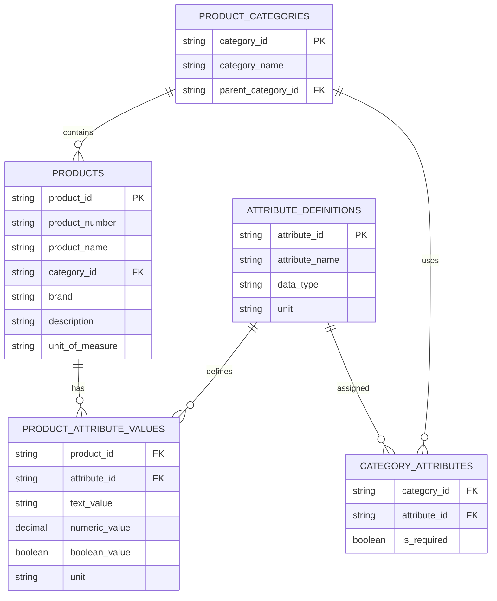
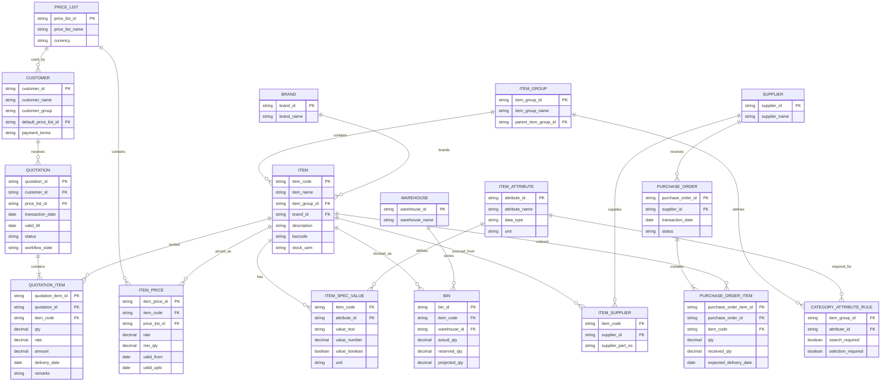
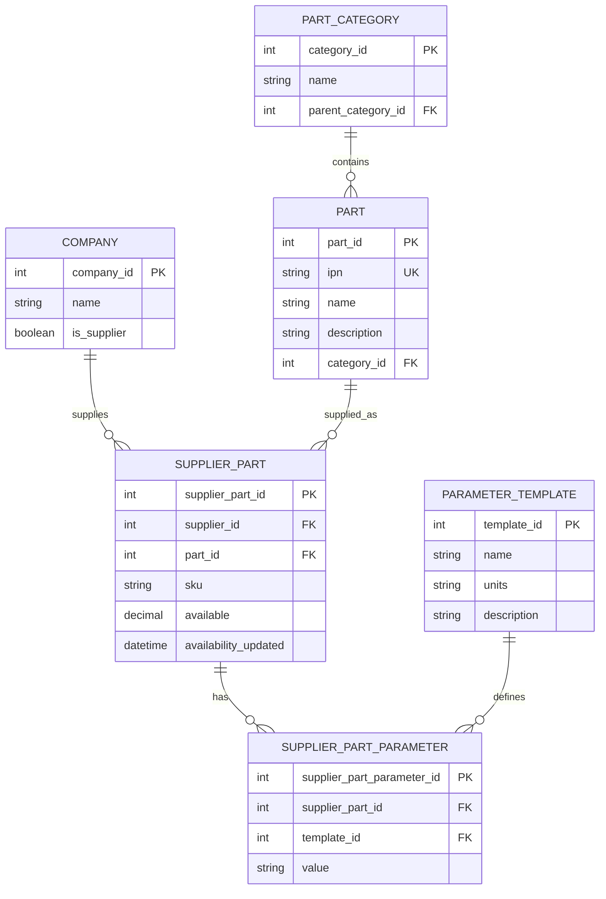
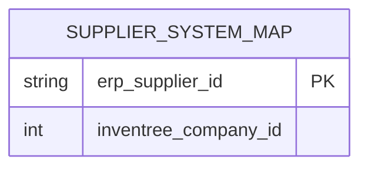

# 見積支援AIエージェント
## データ・ERP連携・業務設計 改訂版

---

# 0. 本資料の目的

本資料は、多品種の商品を扱う専門商社における見積業務を対象に、  
**顧客からの問い合わせ受領から、商品選定、在庫・納期・価格確認、見積作成までを支援するAIエージェント**の開発方針を整理したものである。

今回の開発では、単純なチャットボットや架空のデータベースのみを用いたデモではなく、

- 実在するオープンソースERPを利用する
- 実在するオープン商品データをERPへ投入する
- ERP外の仕入先システムとして、オープンソース在庫管理システム **InvenTree** を利用する
- AIエージェントがERPNextとInvenTreeをAPI経由で横断する
- 人間による確認・承認を残す

ことで、実務に近いケースを再現する。

---

# 1. 想定ケース

## 1.1 対象企業

多品種の商品を扱う中堅の専門商社を想定する。

具体的には、以下のような商品を扱う企業を想定する。

- 業務用機器
- 電気・電子関連商品
- IT・ネットワーク関連商品
- DIY・設備関連商品
- 部品・スペアパーツ
- その他、多数の属性を持つ商品

商品データについては、実在するオープン商品データである **Open Icecat** を主として利用する。

Open Icecatは、ブランド、商品名、カテゴリ、仕様、説明、画像、物流情報などを標準化して提供する商品情報データベースであり、今回のERP商品マスタ構築に適している。

---

## 1.2 主な登場人物

| 主体 | 役割 |
|---|---|
| 顧客企業の購買担当者 | 必要な商品について、仕様・数量・希望納期を整理して見積を依頼する |
| 弊社営業担当者 | 問い合わせを受け、商品検索・在庫・価格・納期確認・見積作成を行う |
| 商品担当者／ベテラン営業 | 商品適合判断が難しい場合に営業担当者を支援する |
| 購買担当者 | 必要に応じて仕入先在庫・納期の確認を行う |
| 上長／承認者 | 作成された見積内容を確認し、承認または差戻しを行う |
| 仕入先担当者 | 仕入先システムで確認できない在庫・納期について回答する |
| AIエージェント | 問い合わせ内容の構造化、商品探索、システム照会、見積Draft作成を支援する |

---

# 2. Before業務

## 2.1 Before業務概要

現状業務は以下とする。

```text
顧客からPDF／メールで問い合わせ
    ↓
要求仕様を確認
    ↓
ERPの商品マスタを検索
    ↓
商品仕様を確認
    ↓
必要に応じて社内有識者へ確認
    ↓
代替品を探索
    ↓
ERPで自社在庫・入荷予定・自社納期を確認
    ↓
自社で充足できない場合、仕入先システムで在庫・納期を確認
    ↓
仕入先システムで確認できない場合、メール・電話で個別照会
    ↓
ERPで顧客別販売価格を確認
    ↓
見積条件を取りまとめ
    ↓
ERPで見積Draftを作成
    ↓
上長が確認・承認
    ↓
顧客へ見積回答
```

---

## 2.2 情報の所在

| 情報 | 主な確認先 |
|---|---|
| 顧客問い合わせ | Outlook / PDF |
| 顧客情報 | ERP |
| 顧客取引条件 | ERP |
| 商品基本情報 | ERP |
| 商品属性・仕様 | ERP、必要に応じメーカー資料 |
| 自社在庫 | ERP |
| 引当済在庫 | ERP |
| 入荷予定 | ERP |
| 自社からの提供可能日 | ERP |
| 顧客別販売価格 | ERP |
| 仕入先情報 | ERP |
| 仕入先在庫 | InvenTree |
| 仕入先取り寄せ納期 | InvenTree（SupplierPartのParameterとして管理） |
| InvenTreeで確認できない仕入先情報 | メール・電話 |
| 見積 | ERP |

---

# 3. 今回利用するデータソース

## 3.1 Open Icecat

### 用途

Open Icecatを、**ERPNextの商品マスタの元データ**として利用する。

取得対象の主な情報は以下。

- 商品ID
- GTIN / EAN
- メーカー型番
- ブランド
- 商品名
- 商品カテゴリ
- 商品説明
- 商品仕様
- 属性
- 単位
- 重量・寸法等
- 関連商品
- 代替商品情報（利用可能な場合）

Open Icecatは、商品情報をXML、CSV、JSON等で提供しており、商品カテゴリ・仕様情報を標準化して扱える。

### 公式サイト

https://icecat.com/

### Open Icecat

https://icecat.com/structured-data-content-users/

### 今回の役割

```text
Open Icecat
    ↓
商品データ取得
    ↓
必要カテゴリを抽出
    ↓
商品・カテゴリ・属性をERPNext用へ変換
    ↓
ERPNextへ投入
```

---

## 3.2 Amazon ESCI

ESCIはERPの商品マスタとしてではなく、  
**商品検索アルゴリズムの評価用データセット**として利用する。

ESCIには、

- Query
- Product
- Exact
- Substitute
- Complement
- Irrelevant

の人手評価ラベルが存在する。

### 公式GitHub

https://github.com/amazon-science/esci-data

### 今回の役割

```text
業務デモ
Open Icecat → ERPNext

検索性能評価
ESCI → 検索アルゴリズムの評価
```

この2つは分離して扱う。

Open Icecatの商品に対してESCIの正解ラベルが存在するとは限らないため、  
ESCIをそのままOpen Icecatの商品検索のGround Truthとして使用しない。

---

# 4. ERPとして利用するシステム

## 4.1 ERPNext

今回の開発では、架空のERPを自作するのではなく、  
**実在するオープンソースERPであるERPNextを利用する。**

ERPNextはFrappe Framework上で動作し、

- 商品
- 顧客
- 在庫
- 倉庫
- 仕入先
- 価格表
- 見積
- 受注

などの業務オブジェクトを標準で持つ。

---

## 4.2 ERPNextを採用する理由

今回ERPNextを採用する理由は以下。

1. オープンソースである
2. ローカルPCに構築できる
3. 商品・顧客・在庫・価格・見積等を標準で扱える
4. REST APIが標準提供されている
5. AIエージェントからAPI経由で操作できる
6. 実在ERPとの連携経験として説明できる

Frappe Frameworkでは、各DocTypeに対してREST APIが自動提供され、

```text
GET    /api/resource/{doctype}
POST   /api/resource/{doctype}
GET    /api/resource/{doctype}/{name}
PUT    /api/resource/{doctype}/{name}
DELETE /api/resource/{doctype}/{name}
```

等の操作が可能である。

---

# 5. システム全体構成

```text
                    ┌──────────────────────┐
                    │ 顧客メール / PDF     │
                    └──────────┬───────────┘
                               │
                               ▼
                    ┌──────────────────────┐
                    │ 見積支援AI Agent     │
                    │                      │
                    │ ・要求仕様抽出       │
                    │ ・商品探索           │
                    │ ・代替品探索         │
                    │ ・各システム照会     │
                    │ ・見積条件整理       │
                    └──────────┬───────────┘
                               │
             ┌─────────────────┼─────────────────┐
             │                 │                 │
             ▼                 ▼                 ▼
      ┌────────────┐   ┌──────────────┐   ┌─────────────┐
      │ ERPNext    │   │ InvenTree    │   │ メーカー資料 │
      │            │   │ Supplier Sys │   │ Web / PDF    │
      │ 商品       │   │              │   │              │
      │ 顧客       │   │ 仕入先在庫   │   │ 詳細仕様     │
      │ 自社在庫   │   │ 仕入先納期   │   │              │
      │ 入荷予定   │   └──────────────┘   └─────────────┘
      │ 顧客価格   │
      │ 見積       │
      └─────┬──────┘
            │
            ▼
      ┌──────────────┐
      │ Quotation    │
      │ Draft作成    │
      └─────┬────────┘
            │
            ▼
      ┌──────────────┐
      │ 上長確認・承認 │
      └─────┬────────┘
            │
            ▼
      顧客へ見積回答
```

---

# 6. ERPNext内で管理するデータ

今回、ERPNext内には以下を保持する。

| データ | データの作り方 |
|---|---|
| 商品 | Open Icecatから取得 |
| 商品カテゴリ | Open Icecatから変換 |
| 商品属性 | Open Icecatから変換 |
| ブランド | Open Icecatから取得 |
| 顧客 | 合成データ |
| 顧客別価格 | 合成データ |
| 倉庫 | 合成データ |
| 自社在庫 | 合成データ |
| 引当 | 合成データ |
| 入荷予定 | 合成データ |
| 仕入先 | 合成データ |
| 見積 | AgentがERPNextへ作成 |

---

# 7. ERP型の商品データ構造

ERP商品データは、すべての商品属性をproductsテーブルの固定列で持つのではなく、  
カテゴリごとに異なる属性を別構造で保持する考え方とする。

例えば、

```text
ネジ
- 径
- 長さ
- ピッチ
- 材質

モニター
- 画面サイズ
- 解像度
- リフレッシュレート
```

のように、商品カテゴリごとに属性が異なるためである。

概念モデルは以下。



実際のERPNextではERPNext標準DocTypeへマッピングするため、  
上記は論理構造として扱う。

---


## 7.1 ERPNext最終論理ER図

以下は、今回のMVPで利用するERPNext側のデータを論理的に整理したER図である。  
実際のERPNextでは各エンティティはDocTypeおよびその子テーブルとして実装されるため、物理DBテーブル名と1対1で一致するとは限らない。



### 7.1.1 補足

`CATEGORY_ATTRIBUTE_RULE` は、To-Be業務で定義した「商品カテゴリごとの検索必須属性が充足しているか」を判定するための論理マスタである。  
MVPではERPNextのカスタムDocTypeとして実装するか、見積支援AIアプリ側の設定マスタとして保持する。

`ITEM_SPEC_VALUE` も、商品カテゴリごとに異なる仕様値を統一的に扱うための論理エンティティであり、ERPNext標準のItem Attribute等で不足する場合のみカスタム構造を追加する。

---

## 7.2 ERPNext論理テーブル・カラム定義

### ITEM_GROUP

| カラム | 型 | キー | 必須 | 内容 |
|---|---|---|---|---|
| item_group_id | string | PK | ○ | 商品カテゴリ識別子 |
| item_group_name | string |  | ○ | 商品カテゴリ名 |
| parent_item_group_id | string | FK |  | 親商品カテゴリ |

### BRAND

| カラム | 型 | キー | 必須 | 内容 |
|---|---|---|---|---|
| brand_id | string | PK | ○ | ブランド識別子 |
| brand_name | string |  | ○ | ブランド名 |

### ITEM

| カラム | 型 | キー | 必須 | 内容 |
|---|---|---|---|---|
| item_code | string | PK | ○ | ERPNextの商品コード。InvenTree `Part.IPN`との共通商品ID |
| item_name | string |  | ○ | 商品名 |
| item_group_id | string | FK | ○ | 商品カテゴリ |
| brand_id | string | FK |  | ブランド |
| description | string |  |  | 商品説明 |
| barcode | string |  |  | GTIN/EAN等 |
| stock_uom | string |  | ○ | 在庫単位 |

### ITEM_ATTRIBUTE

| カラム | 型 | キー | 必須 | 内容 |
|---|---|---|---|---|
| attribute_id | string | PK | ○ | 商品属性識別子 |
| attribute_name | string |  | ○ | 属性名 |
| data_type | string |  | ○ | text / number / boolean 等 |
| unit | string |  |  | 単位 |

### CATEGORY_ATTRIBUTE_RULE

| カラム | 型 | キー | 必須 | 内容 |
|---|---|---|---|---|
| item_group_id | string | FK | ○ | 対象商品カテゴリ |
| attribute_id | string | FK | ○ | 対象属性 |
| search_required | boolean |  | ○ | 商品検索開始時の必須属性か |
| selection_required | boolean |  | ○ | 商品最終確定時の必須属性か |

### ITEM_SPEC_VALUE

| カラム | 型 | キー | 必須 | 内容 |
|---|---|---|---|---|
| item_code | string | FK | ○ | 対象商品 |
| attribute_id | string | FK | ○ | 対象属性 |
| value_text | string |  |  | 文字列型の属性値 |
| value_number | decimal |  |  | 数値型の属性値 |
| value_boolean | boolean |  |  | 真偽値型の属性値 |
| unit | string |  |  | 値の単位 |

### CUSTOMER

| カラム | 型 | キー | 必須 | 内容 |
|---|---|---|---|---|
| customer_id | string | PK | ○ | 顧客識別子 |
| customer_name | string |  | ○ | 顧客名 |
| customer_group | string |  |  | 顧客グループ |
| default_price_list_id | string | FK |  | 標準適用価格表 |
| payment_terms | string |  |  | 支払条件 |

### PRICE_LIST

| カラム | 型 | キー | 必須 | 内容 |
|---|---|---|---|---|
| price_list_id | string | PK | ○ | 価格表識別子 |
| price_list_name | string |  | ○ | 価格表名 |
| currency | string |  | ○ | 通貨 |

### ITEM_PRICE

| カラム | 型 | キー | 必須 | 内容 |
|---|---|---|---|---|
| item_price_id | string | PK | ○ | 商品価格識別子 |
| item_code | string | FK | ○ | 対象商品 |
| price_list_id | string | FK | ○ | 対象価格表 |
| rate | decimal |  | ○ | 販売単価 |
| min_qty | decimal |  |  | 最低数量／数量条件 |
| valid_from | date |  |  | 適用開始日 |
| valid_upto | date |  |  | 適用終了日 |

### WAREHOUSE

| カラム | 型 | キー | 必須 | 内容 |
|---|---|---|---|---|
| warehouse_id | string | PK | ○ | 倉庫識別子 |
| warehouse_name | string |  | ○ | 倉庫名 |

### BIN

| カラム | 型 | キー | 必須 | 内容 |
|---|---|---|---|---|
| bin_id | string | PK | ○ | 商品×倉庫単位の在庫識別子 |
| item_code | string | FK | ○ | 商品 |
| warehouse_id | string | FK | ○ | 倉庫 |
| actual_qty | decimal |  | ○ | 現在庫 |
| reserved_qty | decimal |  | ○ | 引当済数量 |
| projected_qty | decimal |  |  | 入出庫予定を考慮した予測在庫 |

### SUPPLIER

| カラム | 型 | キー | 必須 | 内容 |
|---|---|---|---|---|
| supplier_id | string | PK | ○ | ERPNext側の仕入先識別子 |
| supplier_name | string |  | ○ | 仕入先名 |

### ITEM_SUPPLIER

| カラム | 型 | キー | 必須 | 内容 |
|---|---|---|---|---|
| item_code | string | FK | ○ | 商品 |
| supplier_id | string | FK | ○ | 取引可能な仕入先 |
| supplier_part_no | string |  |  | ERPNext側で保持する仕入先品番 |

### PURCHASE_ORDER

| カラム | 型 | キー | 必須 | 内容 |
|---|---|---|---|---|
| purchase_order_id | string | PK | ○ | 発注識別子 |
| supplier_id | string | FK | ○ | 発注先仕入先 |
| transaction_date | date |  | ○ | 発注日 |
| status | string |  | ○ | Draft / Submitted / Completed 等 |

### PURCHASE_ORDER_ITEM

| カラム | 型 | キー | 必須 | 内容 |
|---|---|---|---|---|
| purchase_order_item_id | string | PK | ○ | 発注明細識別子 |
| purchase_order_id | string | FK | ○ | 発注 |
| item_code | string | FK | ○ | 商品 |
| qty | decimal |  | ○ | 発注数量 |
| received_qty | decimal |  | ○ | 入荷済数量 |
| expected_delivery_date | date |  |  | 入荷予定日 |

### QUOTATION

| カラム | 型 | キー | 必須 | 内容 |
|---|---|---|---|---|
| quotation_id | string | PK | ○ | 見積識別子 |
| customer_id | string | FK | ○ | 顧客 |
| price_list_id | string | FK |  | 適用価格表 |
| transaction_date | date |  | ○ | 見積日 |
| valid_till | date |  |  | 見積有効期限 |
| status | string |  | ○ | Draft等の状態 |
| workflow_state | string |  |  | 承認／差戻し等のワークフロー状態 |

### QUOTATION_ITEM

| カラム | 型 | キー | 必須 | 内容 |
|---|---|---|---|---|
| quotation_item_id | string | PK | ○ | 見積明細識別子 |
| quotation_id | string | FK | ○ | 見積 |
| item_code | string | FK | ○ | 商品 |
| qty | decimal |  | ○ | 見積数量 |
| rate | decimal |  | ○ | 単価 |
| amount | decimal |  | ○ | 金額 |
| delivery_date | date |  |  | 提供予定日 |
| remarks | string |  |  | 代替品差分・注意事項等 |

---

# 8. Open Icecatデータの変換

## 8.1 加工前

Open Icecatには、例えば以下の情報が存在する。

```text
Icecat Product
├─ Product ID
├─ Brand
├─ Brand Product Code
├─ GTIN
├─ Category
├─ Title
├─ Description
├─ Feature Group
├─ Feature
└─ Feature Value
```

---

## 8.2 加工後

ERPNextへ投入する際は、

```text
Open Icecat
        ↓
ETL
        ↓
ERPNext
```

の変換処理を行う。

### 変換例

| Open Icecat | ERPNext |
|---|---|
| Product ID | Item Code |
| Product Name / Title | Item Name |
| Category | Item Group |
| Brand | Brand |
| Description | Description |
| GTIN | Barcode |
| Feature | Item Attribute |
| Feature Value | Attribute Value |

---

# 9. 模擬データとして生成する情報

Open Icecatには企業固有の業務データは存在しないため、以下は合成する。

## 9.1 顧客

```text
customer_id
customer_name
customer_group
price_list
payment_terms
```

---

## 9.2 自社倉庫

例：

```text
東京倉庫
大阪倉庫
```

---

## 9.3 在庫

各商品について、

```text
actual_qty
reserved_qty
available_qty
```

を設定する。

---

## 9.4 入荷予定

一部商品について、

```text
product_id
quantity
expected_arrival_date
```

を設定する。

これにより、

> 現在庫では不足しているが、3日後の入荷で充足できる

という業務ケースを再現する。

---

## 9.5 顧客別価格

例えば、

```text
標準価格 100,000円

顧客A
90,000円

顧客B
95,000円
```

のように顧客別価格を設定する。

ERPNextではPrice List / Item Price等を利用する。

---

# 10. 仕入先システム（InvenTree）

仕入先側在庫と取り寄せ納期については、ERPNext内だけで完結させず、  
**オープンソース在庫管理システム InvenTree を仕入先ポータル／仕入先システムとしてローカルPC上に構築する。**

InvenTree本体は改造せず、公式Docker環境、標準データモデル、標準REST API、Data Import機能を利用する。  
今回の目的は仕入先システムそのものを開発することではなく、**AIエージェントが実在する別システムをAPI経由で操作するAs-Is環境を短時間で再現すること**である。

---

## 10.1 ローカル構築方法

### 採用方式

以下の構成でWindows PC上に構築する。

- Docker Desktop
- Docker Compose
- InvenTree Stable Docker Image
- PostgreSQL
- Redis
- Caddy
- InvenTree Worker

InvenTreeのソースコード自体は変更せず、公式Docker構成をそのまま利用する。

### Docker構成

```text
Docker Desktop
│
└─ InvenTree Docker Compose
   ├─ inventree-server
   ├─ PostgreSQL
   ├─ Redis
   ├─ inventree-worker
   └─ Caddy
```

### 初期構築の基本手順

1. InvenTree公式Docker構成ファイルを取得する
2. `.env`を設定する
3. 永続化ディレクトリを設定する
4. DBユーザー・パスワードを設定する
5. 初期DBを構築する
6. 管理者ユーザーを作成する
7. Docker Composeを起動する
8. Web画面からログインできることを確認する
9. `/api-doc/`からREST API仕様を確認する

初期DB更新の例：

```bash
docker compose run --rm inventree-server invoke update
```

管理者作成の例：

```bash
docker compose run inventree-server invoke superuser
```

起動：

```bash
docker compose up -d
```

公式構成ではローカル環境からInvenTreeへアクセスできる。  
ERPNextと同一PC上で起動するため、ポート競合がある場合はInvenTree側またはERPNext側の公開ポートを変更する。

### 公式情報

- InvenTree公式サイト: https://inventree.org/
- GitHub: https://github.com/inventree/InvenTree
- Docker構築手順: https://docs.inventree.org/en/latest/start/docker_install/
- REST API: https://docs.inventree.org/en/latest/api/

---

## 10.2 InvenTreeで利用する標準データモデル

今回のMVPではInvenTreeの機能をすべて利用せず、以下の最小構成のみ使用する。

```text
Company
  └─ Supplier

Part
  └─ 共通商品

SupplierPart
  ├─ Supplier
  ├─ Part
  ├─ Supplier SKU
  ├─ Available
  ├─ Availability Updated
  └─ Parameters
       └─ lead_time_days
```

### Company

仕入先企業を表す。

例：

- Supplier A
- Supplier B
- Supplier C

今回利用するCompanyは仕入先として登録する。

### Part

ERPNextの商品と対応する共通商品を表す。

主に以下を利用する。

- `IPN`: ERPNext Item Codeとの連携キー
- `Name`: 商品名
- `Description`: 商品説明

### SupplierPart

特定の仕入先が販売している商品を表す。

主に以下を利用する。

- `SKU`: 仕入先独自の商品コード
- `part`: 対応するPart
- `supplier`: 仕入先
- `available`: 仕入先側の利用可能数量
- `availability_updated`: 在庫情報の更新日時
- `parameters`: 追加属性

AIエージェントが仕入先在庫・納期を確認するときは、主としてSupplierPartを参照する。

---

## 10.3 REST API

AIエージェントからInvenTreeのDBを直接参照せず、**InvenTree標準REST API**を利用する。

### 認証

AIエージェント専用ユーザーを作成し、Token Authenticationを利用する。

HTTP Header例：

```text
Authorization: Token {INVENTREE_API_TOKEN}
```

Agent用ユーザーには、今回必要な参照系操作を中心に最小権限を付与する。

### 商品検索

ERPNextの商品コードに対応するInvenTree Partを取得する。

```http
GET /api/part/?IPN={item_code}
```

### SupplierPart検索

対象Partに紐づく仕入先商品を取得する。

```http
GET /api/company/part/?part={part_id}
```

利用する主なレスポンス項目：

- supplier
- SKU
- available
- availability_updated
- parameters

### Agentに公開するTool

AIエージェントにはInvenTreeのAPI仕様を直接扱わせず、アプリケーション側で以下のような業務Toolへラップする。

```text
get_supplier_availability(item_code)
get_supplier_lead_time(item_code)
```

戻り値の例：

```json
{
  "item_code": "ICECAT-000001",
  "supplier": "Supplier A",
  "supplier_sku": "A-001",
  "available_qty": 50,
  "lead_time_days": 3,
  "availability_updated": "2026-09-26T10:00:00"
}
```

---

## 10.4 ERPNextとの商品ID連携

ERPNextとInvenTreeの間では、共通商品コードを1つ定義する。

以下の対応とする。

```text
ERPNext
Item.item_code
      =
共通商品ID
      =
InvenTree
Part.IPN
```

例：

```text
ERPNext Item Code
ICECAT-000123

InvenTree Part IPN
ICECAT-000123

Supplier A SKU
A-85920

Supplier B SKU
B-22481
```

仕入先SKUは共通商品IDには使用しない。

1つの商品に対して複数のSupplierPartが紐づくため、

```text
ERPNext Item Code
      ↓
InvenTree Part.IPN
      ↓
SupplierPart一覧
      ├─ Supplier A SKU
      ├─ Supplier B SKU
      └─ Supplier C SKU
```

という関係になる。

AIエージェントはERPNextで商品を確定した後、その`item_code`を利用してInvenTreeのPartを検索し、SupplierPartを取得する。

---

## 10.5 仕入先納期の管理方法

InvenTree標準SupplierPartでは、今回必要な「標準取り寄せ納期（日数）」を専用フィールドとして持たせるのではなく、**Parameter機能を利用する。**

### Parameter Template

以下を作成する。

```text
Name:
lead_time_days

Description:
仕入先から自社への標準取り寄せリードタイム（日）
```

例：

```text
SupplierPart
SKU = A-001

available = 50

Parameter:
lead_time_days = 3
```

### 納期不明の再現

以下のようなデータも意図的に作成する。

```text
lead_time_days = 3
lead_time_days = 14
lead_time_days = NULL
```

`lead_time_days`が存在しない、または仕入先在庫情報も取得できない場合は、

```text
InvenTreeで確認不可
      ↓
営業／購買担当者へ通知
      ↓
仕入先へメールまたは電話
```

というAs-Is業務の例外処理へ分岐させる。

---

## 10.6 初期データ投入方法

MVPではInvenTree標準の**Data Import機能によるCSV投入を優先**する。

理由は、初期段階でPython投入スクリプトや専用API処理を作成するよりも、短時間でデータを用意できるためである。

### 投入順序

データ間に参照関係があるため、以下の順番で登録する。

1. Company / Supplier
2. Part Category
3. Part
4. SupplierPart
5. Parameter Template
6. Parameter

### MVP初期データ量

最初は以下を目安とする。

```text
Supplier：3～5社
Part：100商品
SupplierPart：100～300件
```

例として、100商品に平均2仕入先を設定した場合、約200件のSupplierPartとなる。

### Supplierデータ例

| supplier_name | is_supplier |
|---|---|
| Supplier A | true |
| Supplier B | true |
| Supplier C | true |

### Partデータ例

| IPN | Name |
|---|---|
| ICECAT-000001 | Product A |
| ICECAT-000002 | Product B |

### SupplierPartデータ例

| Part | Supplier | SKU | Available |
|---|---|---|---:|
| ICECAT-000001 | Supplier A | A-001 | 50 |
| ICECAT-000001 | Supplier B | B-552 | 0 |
| ICECAT-000002 | Supplier A | A-019 | 120 |

### テストケース用データ

正常系だけでなく、以下の状態を意図的に混在させる。

| ケース | 在庫 | 納期 | 更新日時 | 想定動作 |
|---|---:|---|---|---|
| A | あり | あり | 最新 | そのまま見積条件へ利用 |
| B | なし | あり | 最新 | 取り寄せ可否を判断 |
| C | あり | 不明 | 最新 | 納期の個別確認 |
| D | 不明 | 不明 | - | 仕入先への個別照会 |
| E | あり | あり | 古い | 情報鮮度不足として再確認 |

大量投入前に少量データでImportテストを実施し、問題がないことを確認してから本番のMVPデータを投入する。

---

## 10.7 AIエージェントによるInvenTree照会フロー

```text
ERPNext
Item Code取得
      ↓
GET /api/part/?IPN={item_code}
      ↓
InvenTree Part ID取得
      ↓
GET /api/company/part/?part={part_id}
      ↓
SupplierPart一覧取得
      ↓
在庫・納期・更新日時を確認
      ↓
利用可能な仕入先を選択
      ↓
見積条件へ反映
```

在庫・納期が確認できない場合は、AIが推測で補完せず、仕入先への個別照会が必要であることを営業／購買担当者へ提示する。

---

## 10.8 ERPNextとInvenTreeの役割分担

| 情報・処理 | ERPNext | InvenTree |
|---|---:|---:|
| 商品マスタ | ○ | ○（連携用Part） |
| 顧客 | ○ | - |
| 自社在庫 | ○ | - |
| 自社入荷予定 | ○ | - |
| 顧客別販売価格 | ○ | - |
| 自社側仕入先情報 | ○ | - |
| 仕入先企業 | - | ○ |
| 仕入先SKU | - | ○ |
| 仕入先側在庫 | - | ○ |
| 仕入先取り寄せ納期 | - | ○ |
| 仕入先情報更新日時 | - | ○ |
| Quotation | ○ | - |

ERPNextとInvenTreeは商品コードを介して連携し、AIエージェントが両システムを横断する。

---

## 10.9 InvenTree最終論理ER図

今回のMVPでは、InvenTreeのうち仕入先在庫・納期照会に必要な最小構成のみを利用する。  
以下は今回使用する論理エンティティのER図である。



---

## 10.10 InvenTree論理テーブル・カラム定義

### PART_CATEGORY

| カラム | 型 | キー | 必須 | 内容 |
|---|---|---|---|---|
| category_id | int | PK | ○ | InvenTreeの商品カテゴリ識別子 |
| name | string |  | ○ | カテゴリ名 |
| parent_category_id | int | FK |  | 親カテゴリ |

### PART

| カラム | 型 | キー | 必須 | 内容 |
|---|---|---|---|---|
| part_id | int | PK | ○ | InvenTree内部の商品識別子 |
| ipn | string | UK | ○ | Internal Part Number。ERPNext `Item.item_code`との共通商品ID |
| name | string |  | ○ | 商品名 |
| description | string |  |  | 商品説明 |
| category_id | int | FK |  | 商品カテゴリ |

### COMPANY

| カラム | 型 | キー | 必須 | 内容 |
|---|---|---|---|---|
| company_id | int | PK | ○ | InvenTree内部の企業識別子 |
| name | string |  | ○ | 仕入先企業名 |
| is_supplier | boolean |  | ○ | 仕入先として利用する企業か |

### SUPPLIER_PART

| カラム | 型 | キー | 必須 | 内容 |
|---|---|---|---|---|
| supplier_part_id | int | PK | ○ | 仕入先商品識別子 |
| supplier_id | int | FK | ○ | `COMPANY.company_id` |
| part_id | int | FK | ○ | `PART.part_id` |
| sku | string |  | ○ | 仕入先独自SKU |
| available | decimal |  |  | 仕入先側の利用可能在庫数 |
| availability_updated | datetime |  |  | 在庫情報の最終更新日時 |

### PARAMETER_TEMPLATE

| カラム | 型 | キー | 必須 | 内容 |
|---|---|---|---|---|
| template_id | int | PK | ○ | Parameter定義識別子 |
| name | string |  | ○ | Parameter名。MVPでは`lead_time_days`を利用 |
| units | string |  |  | 単位。例：days |
| description | string |  |  | Parameterの説明 |

### SUPPLIER_PART_PARAMETER

| カラム | 型 | キー | 必須 | 内容 |
|---|---|---|---|---|
| supplier_part_parameter_id | int | PK | ○ | 仕入先商品Parameter識別子 |
| supplier_part_id | int | FK | ○ | 対象SupplierPart |
| template_id | int | FK | ○ | Parameter Template |
| value | string |  |  | Parameter値。`lead_time_days`の場合は日数 |

---

## 10.11 ERPNext・InvenTree間の論理連携キー

ERPNextとInvenTreeは別データベースであるため、DBレベルの外部キーは設定しない。  
AIエージェント／Integration Layerが以下の論理キーを利用して両システムを横断する。

```text
ERPNext
ITEM.item_code
        =
InvenTree
PART.ipn
```

例：

```text
ERPNext Item Code : ICECAT-000123
InvenTree Part IPN: ICECAT-000123
```

商品については上記の共通商品IDで接続する。

仕入先についてはERPNextとInvenTreeで別々の内部IDを持つため、必要に応じて見積支援AIアプリ側のIntegration DBに以下のマッピングを保持する。



### SUPPLIER_SYSTEM_MAP

| カラム | 型 | キー | 必須 | 内容 |
|---|---|---|---|---|
| erp_supplier_id | string | PK | ○ | ERPNext `SUPPLIER.supplier_id` |
| inventree_company_id | int |  | ○ | InvenTree `COMPANY.company_id` |

このマッピングにより、

```text
ERPNextで取引可能仕入先を特定
        ↓
SUPPLIER_SYSTEM_MAPでInvenTree Companyへ変換
        ↓
対象CompanyのSupplierPartを照会
        ↓
仕入先在庫・納期を取得
```

という処理を実現する。

---

# 11. AIエージェントからERPNext・InvenTreeへの接続

AIエージェントからERPNextおよびInvenTreeのDBを直接参照しない。  
各システムのREST APIを、業務目的ごとのAgent Toolとしてラップして利用する。

```text
                   AI Agent
                      │
                 Agent Tool
             ┌────────┴────────┐
             │                 │
             ▼                 ▼
      ERPNext REST API   InvenTree REST API
             │                 │
             ▼                 ▼
          ERPNext          InvenTree
             │                 │
             ▼                 ▼
        ERP Database     InvenTree DB
```

---

## 11.1 Agentに公開するTool

例：

```text
search_products()
get_product_detail()
get_customer()
get_stock()
get_incoming_stock()
get_customer_price()
get_supplier_availability()
get_supplier_lead_time()
create_quotation()
```

Agentには業務に必要な操作のみを公開する。

---

## 11.2 Agentから実施させない操作

例えば、

```text
delete_customer()
delete_item()
direct_stock_update()
submit_order()
```

等はAgentへ公開しない。

AIは業務支援者であり、ERPを自由に操作できるユーザーとはしない。

---

# 12. After業務の基本方針

AI導入後は以下のような流れを目指す。

```text
顧客メール / PDF
    ↓
AIが要求仕様を構造化
    ↓
ERPの商品マスタを検索
    ↓
候補商品を抽出
    ↓
商品仕様を比較
    ↓
代替候補を提示
    ↓
ERPで自社在庫・入荷予定確認
    ↓
必要ならInvenTreeを照会
    ↓
ERPで顧客別販売価格確認
    ↓
AIが見積条件を整理
    ↓
ERPNextにQuotation Draft作成
    ↓
上長が確認・承認
    ↓
顧客回答
```

---

# 13. Human-in-the-loop

以下の判断は人間に残す。

## 商品判断

AIは候補商品・代替商品を提示する。

最終的な採用判断は人間が行う。

---

## 見積承認

AIはQuotation Draft作成までとする。

```text
Draft
 ↓
上長確認
 ↓
承認
 ↓
顧客回答
```

最終承認は人間が行う。

---

## 仕入先個別照会

InvenTreeで在庫・納期が取得できない場合、

```text
AI
↓
情報取得不可
↓
営業／購買担当者へ通知
↓
メール・電話で仕入先へ確認
```

とする。

---

# 14. ERPNext環境の構築

ERPNextは公式のFrappe Docker環境を使ってローカルPCへ構築する。

公式リポジトリ：

https://github.com/frappe/frappe_docker

---

## 14.1 必要ソフトウェア

```text
Docker Desktop
Git
```

---

## 14.2 簡易環境構築

```bash
git clone https://github.com/frappe/frappe_docker
cd frappe_docker
docker compose -f pwd.yml up -d
```

起動後：

```text
http://localhost:8080
```

---

# 15. データ投入手順

## Step 1
Open Icecatへ登録し、商品データを取得する。

↓

## Step 2
今回の業務ケースに適したカテゴリを抽出する。

例：

```text
DIY
Electrical
Networking
Components
Office equipment
Spare parts
```

↓

## Step 3
Python等でデータを解析する。

↓

## Step 4
カテゴリ・属性を正規化する。

```text
Icecat Category
→ ERPNext Item Group

Icecat Feature
→ ERPNext Attribute

Icecat Product
→ ERPNext Item
```

↓

## Step 5
ERPNextへ商品を投入する。

投入方法は、

- CSV Import
- Data Import
- REST API

のいずれかとする。

MVPではまずCSV Importを利用し、  
AI Agentからの操作はREST APIとする。

↓

## Step 6
顧客マスタを合成する。

↓

## Step 7
倉庫を設定する。

↓

## Step 8
在庫データを投入する。

↓

## Step 9
価格表・顧客別価格を投入する。

↓

## Step 10
仕入先情報を登録する。

↓

## Step 11
InvenTreeを構築する。

実施内容：

1. Docker ComposeでInvenTreeをローカル起動
2. Company / Supplierを登録
3. ERPNext Item Codeと同一値をPart.IPNへ設定
4. SupplierPartを登録
5. `lead_time_days` Parameterを作成・投入
6. 在庫・納期・更新日時のテストデータを投入
7. REST APIおよびToken認証を確認

↓

## Step 12
AIエージェントからERPNext・InvenTree REST APIを呼び出す。

---

# 16. MVPデータ量

最初からOpen Icecat全件を投入する必要はない。

MVPでは例えば、

```text
商品カテゴリ：3～5カテゴリ
商品数：1,000～5,000 SKU
顧客：10～20社
倉庫：2拠点
仕入先：3～5社
```

程度から開始する。

InvenTree側は、まず以下を目安とする。

```text
Part：100商品
SupplierPart：100～300件
```

商品検索・Agent連携が安定した後、必要に応じてInvenTree側の商品数も増やす。

検索性能や負荷検証を行う場合は、その後、

```text
10,000
50,000
100,000 SKU
```

へ段階的に増やす。

---

# 17. 検索設計

今回の商品検索では、LLMだけで商品を判断しない。

以下の役割分担とする。

## 構造化検索

例：

```text
サイズ
規格
容量
材質
電圧
メーカー
```

はDB・ルールで検索する。

---

## Semantic Search

商品名・説明等の曖昧検索には、

```text
Embedding
Vector Search
Full Text Search
```

等を利用する。

---

## LLM

LLMは、

- 顧客文章の理解
- 検索条件抽出
- 候補商品の説明
- 商品差分説明
- 見積回答文章生成

に利用する。

---

# 18. ESCIを使った検索品質評価

ESCIでは、

```text
E = Exact
S = Substitute
C = Complement
I = Irrelevant
```

のラベルを利用できる。

評価例：

```text
nDCG@10
Recall@10
MRR
Macro F1
```

ただし、ESCI評価は**検索アルゴリズム単体の技術評価**として行う。

Open Icecat＋ERPNext上の業務デモとは分けて扱う。

---

# 19. 業務デモ用の検索評価

Open Icecatの商品については別途、

```text
問い合わせ
正解商品
許容代替商品
不適合商品
```

を20～50ケース程度作成する。

例：

```text
Query:
27インチ
WQHD
144Hz以上
HDMI対応

Exact:
商品P001

Acceptable Substitute:
商品P004
商品P008
```

これをMVPの評価データセットとして利用する。

---

# 20. MVP機能

| No. | 機能 | MVP内容 |
|---|---|---|
| 1 | 問い合わせ取込 | PDF／メール想定データを読み込む |
| 2 | 要求仕様抽出 | LLMで要求条件をStructured Output化 |
| 3 | 商品検索 | ERPNext商品マスタから候補取得 |
| 4 | 商品仕様比較 | 顧客要求と商品属性を比較 |
| 5 | 代替品探索 | 代替候補を抽出・差分表示 |
| 6 | 自社在庫確認 | ERPNextから在庫取得 |
| 7 | 入荷予定確認 | ERPNextから入荷予定取得 |
| 8 | 仕入先照会 | InvenTree REST APIからSupplierPartの在庫・納期・更新日時を取得 |
| 9 | 顧客別価格 | ERPNextから価格取得 |
| 10 | 見積条件整理 | 商品・数量・価格・納期を統合 |
| 11 | 見積Draft作成 | ERPNext Quotationへ登録 |
| 12 | HITL | 上長が承認／差戻し |

---

# 21. MVP対象外

以下は今回の対象外とする。

- 実企業SAP等への接続
- 完全自動受注
- AIによる最終商品採用判断
- AIによる見積最終承認
- 自動メール送信
- 過去見積検索
- 特値・例外価格承認
- 需要予測
- 在庫最適化
- 発注最適化
- 生産計画
- InvenTree本体ソースコードのカスタマイズ

---

# 22. 推奨実装順

## Phase 1：ERP環境

```text
ERPNextをDockerで構築
↓
Item / Customer / Warehouse等を確認
↓
REST APIを試す
```

---

## Phase 2：商品データ

```text
Open Icecat取得
↓
対象カテゴリ選定
↓
商品属性変換
↓
ERPNextへ投入
```

---

## Phase 3：業務データ

```text
顧客
在庫
入荷予定
価格
仕入先
```

を作成。

---

## Phase 4：InvenTree

```text
InvenTreeをDockerで構築
↓
Supplier / Part / SupplierPartを登録
↓
ERPNext Item Code = InvenTree Part.IPNで連携
↓
lead_time_days Parameterを登録
↓
在庫・納期・更新日時のテストデータを投入
↓
Token認証・REST APIを確認
```

---

## Phase 5：AI Agent

```text
PDF
↓
仕様抽出
↓
商品検索
↓
在庫
↓
納期
↓
価格
↓
Quotation
```

まで接続。

---

## Phase 6：HITL

```text
Quotation Draft
↓
上長確認
↓
承認 / 差戻し
```

を実装。

---

# 23. 今回のポートフォリオとしての説明

最終的には、以下のように説明できる状態を目指す。

> 多品種専門商社の見積業務を題材に、実在するオープンソースERPであるERPNextをローカル環境に構築した。
>
> Open Icecatの商品データをERP型の商品マスタへ変換・投入し、顧客・自社在庫・入荷予定・顧客別価格等の模擬業務データを構築した。
>
> また、自社ERPだけでは把握できない仕入先在庫・取り寄せ納期については、オープンソース在庫管理システムInvenTreeをローカル環境に構築し、仕入先システムとして利用した。
>
> AIエージェントが顧客のPDF／メールから要求仕様を抽出し、ERPNext・InvenTreeをREST API経由で横断して商品候補、自社在庫、仕入先在庫、納期、価格を取得し、ERPNext上にQuotation Draftを作成する。
>
> 商品選定および見積承認などの高リスク判断についてはHuman-in-the-loopを残し、人間が最終判断を行う。

---

# 24. 今回の構成の狙い

今回の開発では、単なる生成AIアプリの開発ではなく、

```text
非構造データ理解
        +
商品マスタ検索
        +
ERP API連携
        +
InvenTree API連携
        +
業務ルール
        +
例外処理
        +
Human-in-the-loop
```

を一連で経験する。

これにより、AI-BPR / FDE案件に近い、

> 「既存の業務システムを残したまま、AIエージェントをその上に組み込み、業務プロセス全体を再設計する」

という実務型のポートフォリオとする。
